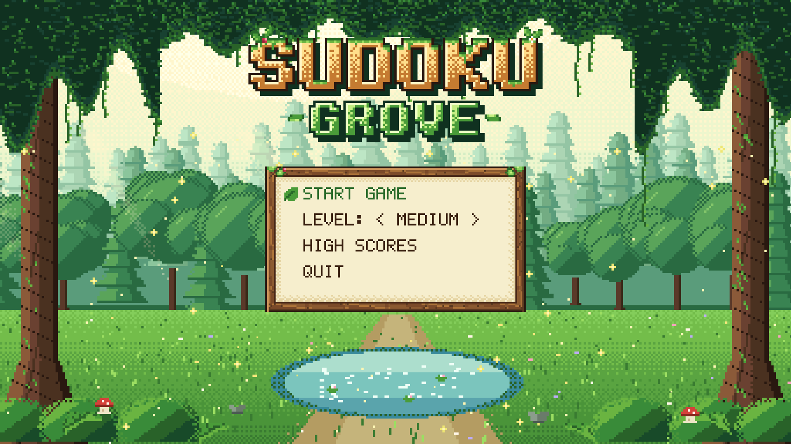
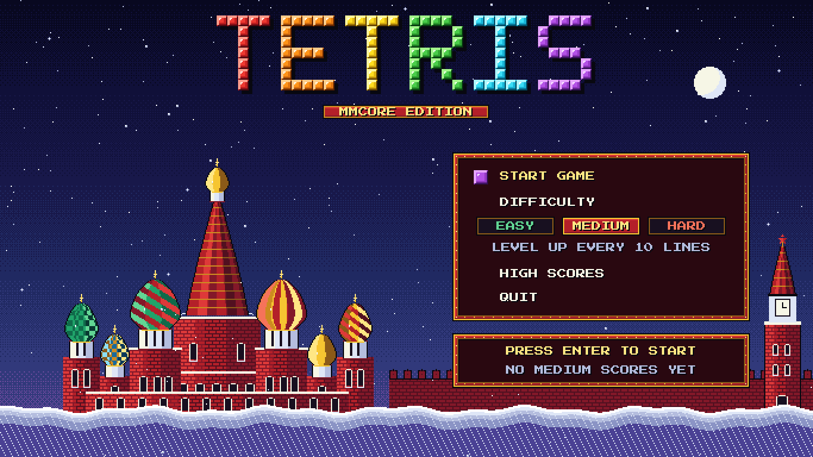
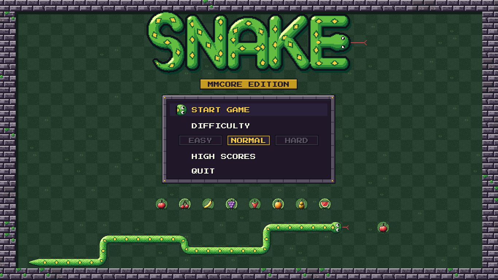
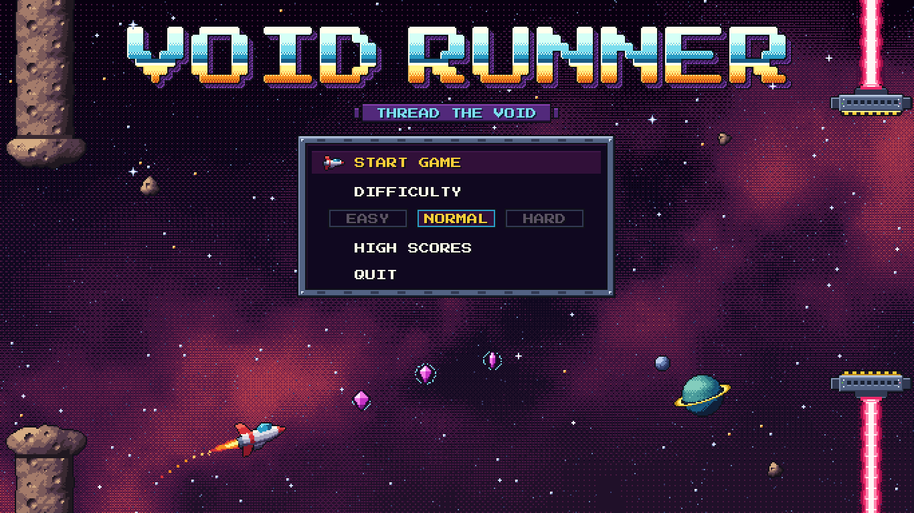
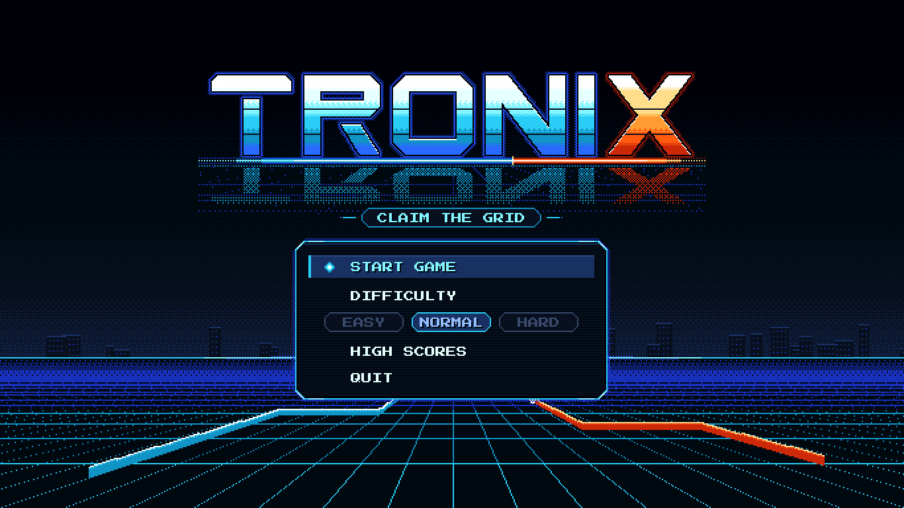
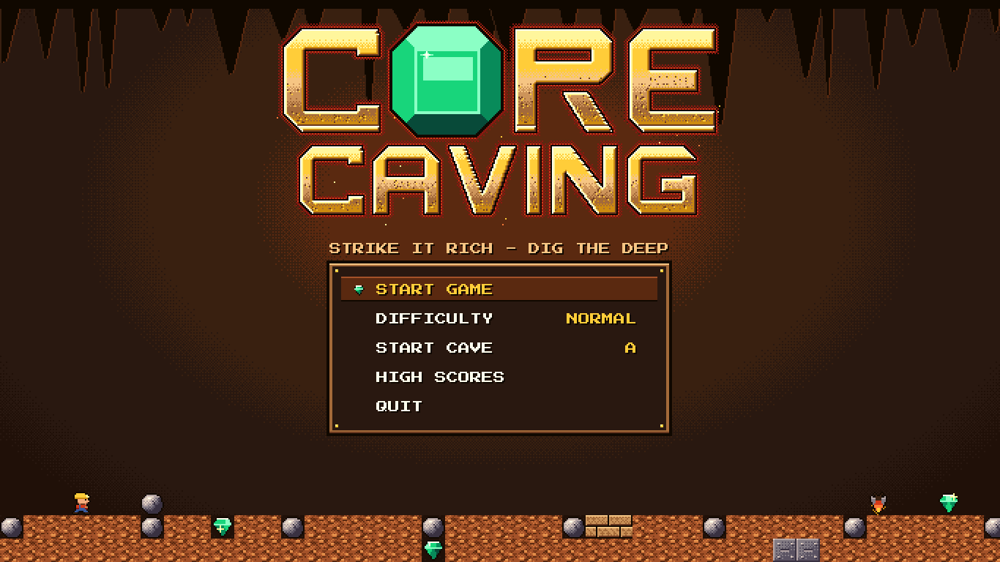
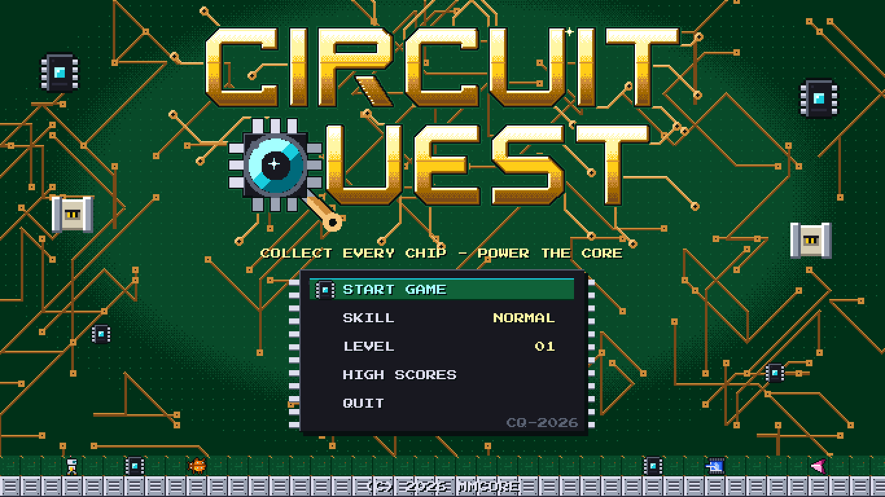
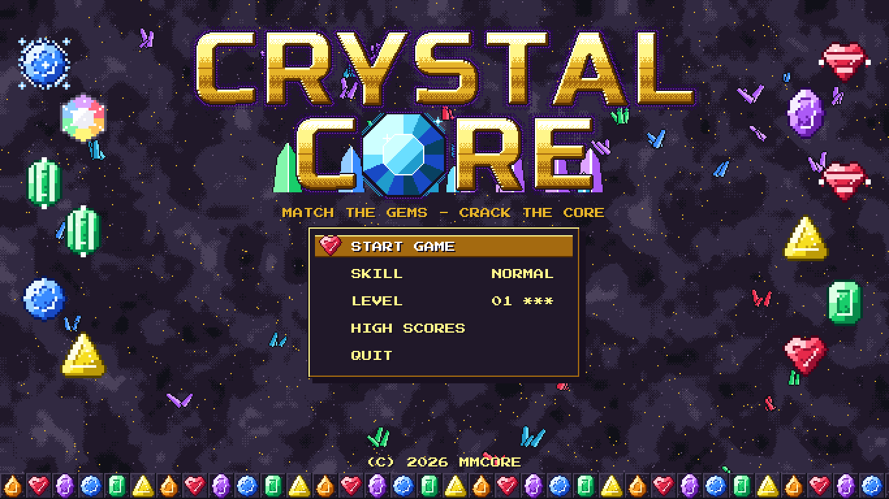
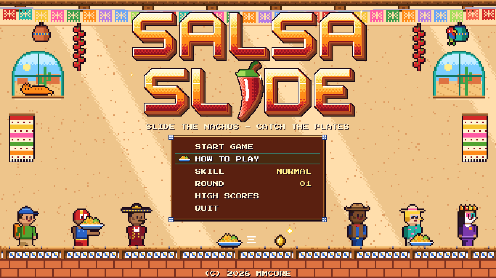

# mmcore-apps

Apps and games for mmcore.

## Games

Games for mmcore (MMBasic, Colour Maximite 2 style). Each game lives in its
own folder; run its main .bas file from the mmcore prompt with RUN (RUN changes into the
game's folder, so its gfx/, sfx/ and data files resolve relative to it).

| Title screen | Game | Folder |
|--------------|------|--------|
|  | Sudoku Grove - a calm forest sudoku | [games/sudoku/](games/sudoku/) |
|  | Tetris - mmcore edition, Soviet-style falling blocks | [games/tetris/](games/tetris/) |
|  | Snake - mmcore edition, 10 garden levels, high scores | [games/snake/](games/snake/) |
|  | Void Runner - Flappy-style space flight through asteroid and laser gaps, speed ramps up | [games/voidrunner/](games/voidrunner/) |
|  | TRONIX - Xonix on the neon Grid: claim 75% of the grid, dodge orbs and sentinels | [games/tronix/](games/tronix/) |
|  | Core Caving - Boulder Dash style digging: 16 caves + 4 bonus caves, boulders, fireflies, butterflies, magic walls, amoeba | [games/corecaving/](games/corecaving/) |
|  | Circuit Quest - Chip's Challenge style puzzles in a silicon lab: 20 levels, keycards and doors, blocks, boots, ice, conveyors, toggle walls, traps, teleports, tanks, bombs, hidden walls | [games/circuitquest/](games/circuitquest/) |
|  | Crystal Core - Candy Crush style match-3 in a crystal mine: 30 levels, striped, charged and rainbow specials, EASY/NORMAL/HARD | [games/crystalcore/](games/crystalcore/) |
|  | Salsa Slide - Tapper-style nacho cantina: slide plates down 4 counters, catch the empties, grab tips, Salsa Shuffle bonus every 4th round, How to Play screen, EASY/NORMAL/HARD | [games/salsaslide/](games/salsaslide/) |
