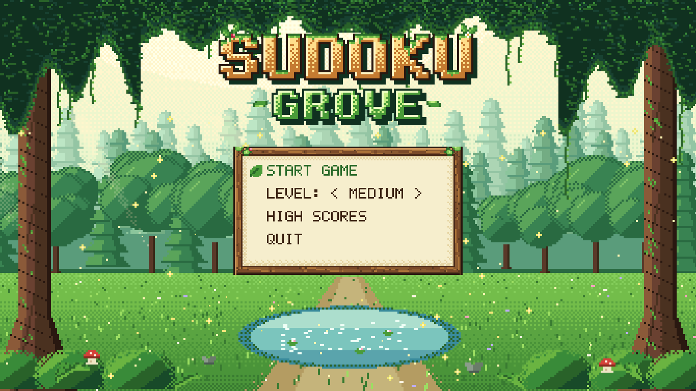
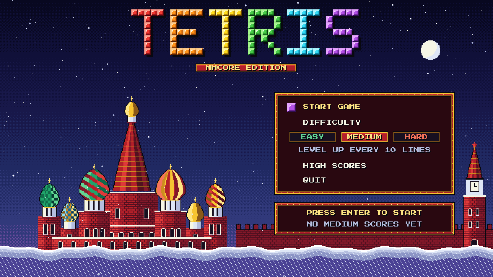
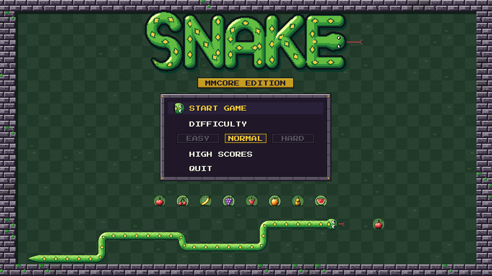
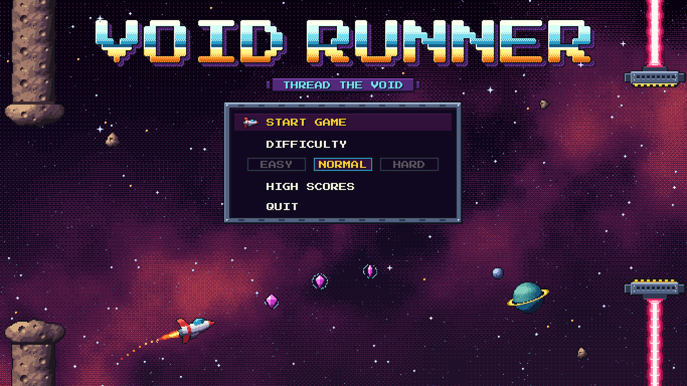
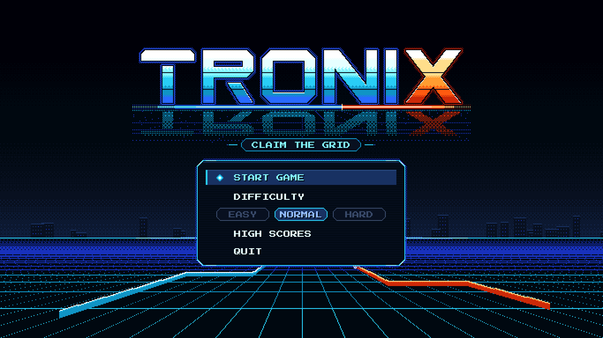
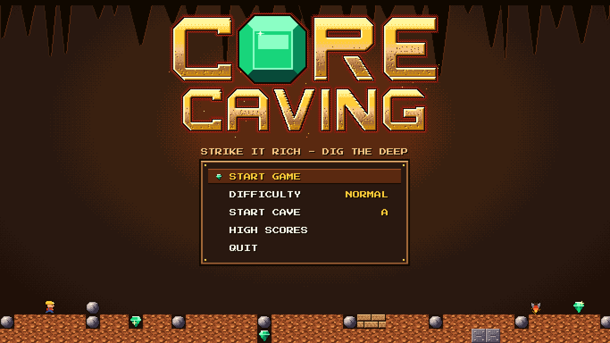
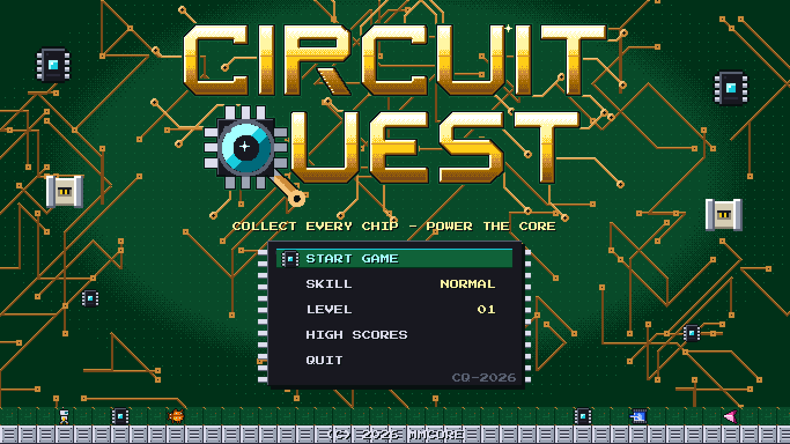
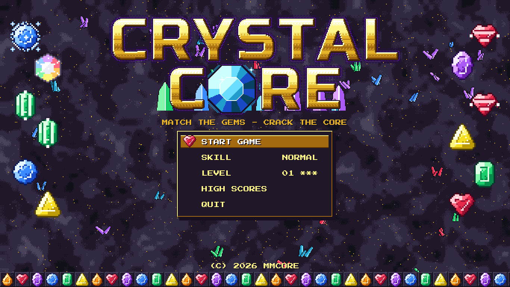
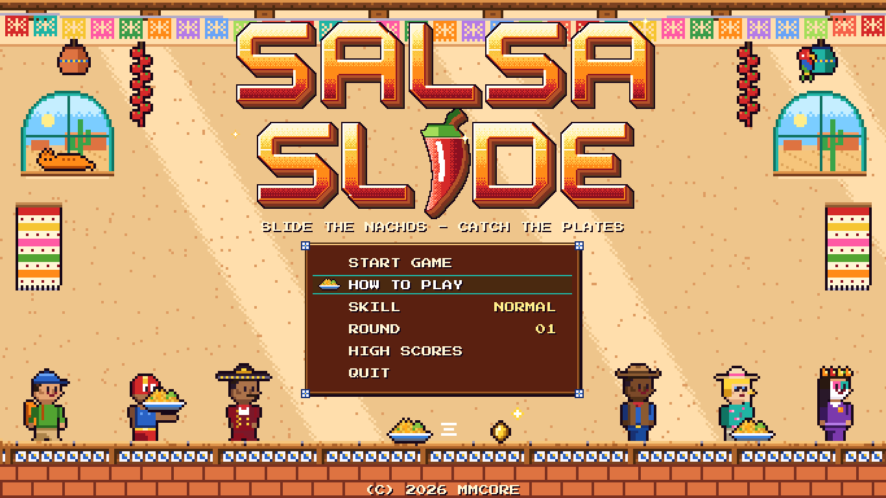

# mmcore-apps

Apps and games for mmcore.

## Packages

`bash tools/package/build-dist.sh` writes `dist/<folder>.app` for every game.
Each file is a ZIP store in the layout mmcore's `PACKAGE` wizard writes
(`PACKAGE.INF` with `name`, `main=MAIN.BAS`, `title`, and `author`), so
`RUN "name.app"` can mount it. The script does not run mmcore. Pushes to
`master` that change `games/` rebuild `dist/` in GitHub Actions and commit
the archives back when the bytes change.

Optional per-game `games/<name>/PACKAGE.INF` is merged when packing (packer
still sets `name` and `main`). Include an `INFO/` folder in the game tree to
ship hub icons, screenshots, and about text inside the archive.

## Hub (hub.mmcore.dev)

The public mmcore HUB loads a static catalogue from
[https://hub.mmcore.dev/](https://hub.mmcore.dev/), which is this repository's
`dist/` folder served as the site root: `dist/index.json`, `dist/<id>.app`,
and `dist/info/<id>/` assets. Official games are packaged into `dist/` by
`build-dist.sh`; optional `community/*.app` submissions (see
[community/README.md](community/README.md)) are copied into `dist/` when the
index is built.

`tools/hub/build_index.py` writes `dist/index.json`, `dist/_headers`, and
`dist/info/`. Index `generated` is the newest git commit touching
`games/`, `community/`, or the hub/packager tools (deterministic, no
wall-clock). Pushes to `master`/`main` that touch `games/`, `community/`,
`dist/` (including `.app` files committed without a `games/` source),
`tools/package/`, or `tools/hub/` run **Package dist apps**
(`.github/workflows/package-dist.yml`): game sources are repacked when
`games/` or the packager change; the hub index is always rebuilt from
whatever `.app` files are in `dist/` plus `community/`. The workflow commits
`dist/` with `[skip ci]` when bytes change so its own push does not retrigger.
Pull requests (including `community/`) run **Hub index** validation only
(tests plus `--dry-run`).

Build locally:

```bash
bash tools/package/build-dist.sh
python3 tools/hub/build_index.py --root .
python3 -m unittest discover -s tools/hub -p "test_*.py" -v
```

Cloudflare Pages: connect this repo, **build command** none, **output
directory** `dist`, custom domain `hub.mmcore.dev` (no wrangler deploy from
Actions).

## Games

Games for mmcore (MMBasic, Colour Maximite 2 style). Each game lives in its
own folder; run its main.bas file from the mmcore prompt with RUN (RUN changes into the
game's folder, so its gfx/, sfx/ and data files resolve relative to it).

| Title screen | Game | Folder |
|--------------|------|--------|
|  | Sudoku Grove - a calm forest sudoku | [games/sudoku/](games/sudoku/) |
|  | Tetris - mmcore edition, Soviet-style falling blocks | [games/tetris/](games/tetris/) |
|  | Snake - mmcore edition, 10 garden levels, high scores | [games/snake/](games/snake/) |
|  | Void Runner - Flappy-style space flight through asteroid and laser gaps, speed ramps up | [games/voidrunner/](games/voidrunner/) |
|  | TRONIX - Xonix on the neon Grid: claim 75% of the grid, dodge orbs and sentinels | [games/tronix/](games/tronix/) |
|  | Core Caving - Boulder Dash style digging: 16 caves + 4 bonus caves, boulders, fireflies, butterflies, magic walls, amoeba | [games/corecaving/](games/corecaving/) |
|  | Circuit Quest - Chip's Challenge style puzzles in a silicon lab: 20 levels, keycards and doors, blocks, boots, ice, conveyors, toggle walls, traps, teleports, tanks, bombs, hidden walls | [games/circuitquest/](games/circuitquest/) |
|  | Crystal Core - Candy Crush style match-3 in a crystal mine: 30 levels, striped, charged and rainbow specials, EASY/NORMAL/HARD | [games/crystalcore/](games/crystalcore/) |
|  | Salsa Slide - Tapper-style nacho cantina: slide plates down 4 counters, catch the empties, grab tips, Salsa Shuffle bonus every 4th round, How to Play screen, EASY/NORMAL/HARD | [games/salsaslide/](games/salsaslide/) |
